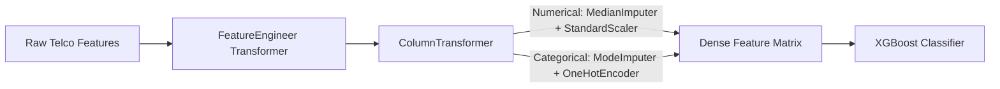

# 📐 Technical Architecture & System Specification: Customer Churn Intelligence

> **System Design, Mathematical Foundations, Pipeline Specifications, and Architectural Tradeoffs for Production Customer Churn Prediction.**

---

## 📑 Table of Contents
1. [System Overview & Business Context](#1-system-overview--business-context)
2. [Data Pipeline & Leakage-Free Transformation Architecture](#2-data-pipeline--leakage-free-transformation-architecture)
3. [Mathematical Foundations of Candidate Models](#3-mathematical-foundations-of-candidate-models)
   - [Logistic Regression & Cross-Entropy](#logistic-regression--binary-cross-entropy)
   - [Random Forest & Bagging Impurity Reduction](#random-forest--bagging)
   - [XGBoost & Second-Order Objective Optimization](#xgboost--second-order-taylor-expansion)
4. [Evaluation Metrics & Decision Threshold Economics](#4-evaluation-metrics--decision-threshold-economics)
5. [Feature Importance & Attribution Analysis](#5-feature-importance--attribution-analysis)
6. [Engineering Decisions & Architectural Tradeoffs](#6-engineering-decisions--architectural-tradeoffs)

---

## 1. System Overview & Business Context

### Problem Statement
Customer Churn refers to the percentage of subscribers who terminate service contracts over a specified observation window. In subscription-based business models (telecom, cloud SaaS, streaming), churn directly impacts Net Revenue Retention (NRR).

### The Financial Equation: CAC vs. LTV
* **Customer Acquisition Cost (CAC)**: The aggregate marketing and sales expense required to sign one net-new subscriber. In telecom, CAC averages **$300 to $600**.
* **Customer Lifetime Value (LTV)**:
  $$\text{LTV} = \frac{\text{Average Monthly Revenue per User (ARPU)} \times \text{Gross Margin}}{\text{Monthly Churn Rate}}$$
* **The ROI of Proactive Intervention**:
  Retaining an existing customer is **5× to 7× more cost-effective** than acquiring a replacement. When the model flags a high churn hazard, targeted automated retention workflows (e.g., selective billing discounts, contract restructuring, device upgrades) preserve customer equity at a fraction of re-acquisition cost.

---

## 2. Data Pipeline & Leakage-Free Transformation Architecture

### The Scikit-Learn Pipeline Specification
In production ML systems, preprocessing must be deterministic, reproducible, and fully serializable:

### Data Leakage Prevention Architecture
* **Leakage Vector**: Computing sample statistics (mean, variance, median, vocabulary, or one-hot categories) across the combined dataset before splitting into train/test.
* **Architecture Implementation**: Preprocessing parameters (`StandardScaler.mean_`, `StandardScaler.scale_`, `OneHotEncoder.categories_`) are strictly estimated **only on `X_train`** inside each cross-validation fold. The test split is held out as unseen production traffic.
* **Encapsulation via `BaseEstimator` and `TransformerMixin`**: All custom transformations (`Num_Services`, `Avg_Monthly_Paid`, `Is_Auto_Pay`) are implemented as standard Scikit-Learn estimators, guaranteeing seamless integration with `GridSearchCV` and clean single-artifact serialization via `joblib.dump(pipeline, "churn_pipeline.joblib")`.

---

## 3. Mathematical Foundations of Candidate Models

### Logistic Regression & Binary Cross-Entropy

#### 1. The Log-Odds (Logit)
Logistic regression models conditional probability $p = P(Y=1|\mathbf{x})$ via the **Sigmoid** activation function:
$$\sigma(z) = \frac{1}{1 + e^{-z}}, \quad \text{where } z = \mathbf{w}^T \mathbf{x} + b$$

The **Odds Ratio** is $\frac{p}{1-p}$. Taking the natural logarithm yields the linear **Log-Odds**:
$$\ln\left(\frac{p}{1-p}\right) = \mathbf{w}^T \mathbf{x} + b$$
* A unit increase in feature $x_j$ multiplies the odds of churning by $e^{w_j}$.

#### 2. Loss Function (Binary Cross-Entropy / Log Loss)
Under maximum likelihood estimation (MLE), the loss for $N$ observations is:
$$\mathcal{L}_{BCE}(\mathbf{w}) = -\frac{1}{N} \sum_{i=1}^N \left[ y_i \ln(\hat{p}_i) + (1 - y_i) \ln(1 - \hat{p}_i) \right]$$
* Convex loss surface ensures guaranteed convergence to the global optimum via gradient descent.

---

### Random Forest & Bagging

Random Forest constructs an ensemble of de-correlated decision trees using **Bootstrap Aggregating (Bagging)** and **Random Subspace Projection**.

#### 1. Splitting Criterion: Gini Impurity
At node $m$ with class proportions $p_{mk}$ for $k \in \{0, 1\}$:
$$I_G(m) = 1 - \sum_{k=0}^1 p_{mk}^2 = 2 p_{m0} p_{m1}$$
* If a node is completely pure (all churn or all non-churn), $I_G = 0$.
* Split quality is evaluated by the weighted reduction in impurity:
  $$\Delta I_G = I_G(m) - \left( \frac{N_{left}}{N_m} I_G(m_{left}) + \frac{N_{right}}{N_m} I_G(m_{right}) \right)$$

#### 2. Variance Reduction Mechanics
If individual trees have variance $\sigma^2$ and average pairwise correlation $\rho$, the ensemble variance across $B$ trees is:
$$\text{Var}(\bar{T}) = \rho \sigma^2 + \frac{1 - \rho}{B} \sigma^2$$
As $B \to \infty$, the second term approaches zero. Randomly sampling feature subsets at each split lowers correlation $\rho$, reducing generalization error.

---

### XGBoost & Second-Order Taylor Expansion

XGBoost builds trees sequentially, fitting successive trees to the negative gradients (pseudo-residuals) of previous iterations.

#### 1. The Regularized Objective
At boosting step $t$, the objective is:
$$\text{Obj}^{(t)} = \sum_{i=1}^N l\left(y_i, \hat{y}_i^{(t-1)} + f_t(\mathbf{x}_i)\right) + \Omega(f_t)$$
Where the tree complexity penalty $\Omega(f)$ constrains leaf count $T$ and leaf weights:
$$\Omega(f_t) = \gamma T + \frac{1}{2} \lambda \sum_{j=1}^T w_j^2$$

#### 2. Second-Order Taylor Approximation
Taking a 2nd-order Taylor expansion of the loss around $\hat{y}_i^{(t-1)}$:
$$\text{Obj}^{(t)} \approx \sum_{i=1}^N \left[ l(y_i, \hat{y}_i^{(t-1)}) + g_i f_t(\mathbf{x}_i) + \frac{1}{2} h_i f_t^2(\mathbf{x}_i) \right] + \Omega(f_t)$$
Where:
$$g_i = \frac{\partial l(y_i, \hat{y}^{(t-1)})}{\partial \hat{y}^{(t-1)}}, \quad h_i = \frac{\partial^2 l(y_i, \hat{y}^{(t-1)})}{\partial (\hat{y}^{(t-1)})^2}$$

#### 3. Closed-Form Optimal Leaf Weight
For leaf $j$ containing sample index set $I_j = \{i : q(\mathbf{x}_i) = j\}$, defining $G_j = \sum_{i \in I_j} g_i$ and $H_j = \sum_{i \in I_j} h_i$:
$$w_j^* = -\frac{G_j}{H_j + \lambda}$$

The resulting split gain is:
$$\text{Gain} = \frac{1}{2} \left[ \frac{G_L^2}{H_L + \lambda} + \frac{G_R^2}{H_R + \lambda} - \frac{(G_L + G_R)^2}{H_L + H_R + \lambda} \right] - \gamma$$
If $\text{Gain} < 0$, the candidate split is pruned.

---

## 4. Evaluation Metrics & Decision Threshold Economics

### The Accuracy Paradox
In customer churn datasets, the majority class (non-churners) represents ~73% of samples. A trivial model predicting "No Churn" unconditionally achieves 73% accuracy while catching **0% of churners**.

### Primary Operational Metrics
* **Recall (Sensitivity)**: $\frac{\text{TP}}{\text{TP} + \text{FN}}$ — What percentage of true churners did the system successfully catch?
* **Precision**: $\frac{\text{TP}}{\text{TP} + \text{FP}}$ — When the system triggers an intervention, how likely is the subscriber to churn?
* **F1-Score**: Harmonic mean: $F_1 = 2 \times \frac{\text{Precision} \times \text{Recall}}{\text{Precision} + \text{Recall}}$.
* **ROC-AUC**: Area Under the Receiver Operating Characteristic Curve. Evaluates ranking quality across all thresholds.

### Economic Threshold Optimization
The default cutoff $\tau = 0.50$ assumes symmetric error costs. In reality:
* **Cost of False Negative (FN)**: Permanent loss of recurring subscriber equity ($300–$600).
* **Cost of False Positive (FP)**: Minor intervention cost ($5–$15).
By sweeping thresholds from $0.10$ to $0.90$, we tune the decision threshold ($\tau = 0.54$) to maximize the F1-score (0.632) and Recall (76.5%) on out-of-sample data.

---

## 5. Feature Importance & Attribution Analysis

### Key Churn Indicators (XGBoost Gain Attribution)
1. **Contract Type (`Month-to-month`)**: Primary churn driver. Month-to-month subscribers face zero contractual friction to switch carriers.
2. **Tenure Duration (`tenure`)**: Churn follows a classical survival curve — hazard rate is highest during the first 6 months, after which account retention stabilizes.
3. **Internet Infrastructure (`Fiber optic`)**: Higher churn rate observed among unbundled fiber subscribers lacking tech support or security add-ons.
4. **Payment Method (`Electronic check`)**: Associated with higher friction and payment failures compared to automated credit card deductions.

---

## 6. Engineering Decisions & Architectural Tradeoffs

### Decision 1: Gradient Boosted Decision Trees vs. Deep Neural Networks
* **Context**: Deciding the primary model family for heterogeneous tabular telemetry data.
* **Rationale**: For tabular records featuring mixed continuous bills and high-cardinality categorical attributes, tree ensembles (XGBoost) consistently outperform deep neural architectures. Decision trees are invariant to monotonic transformations, capture non-linear feature interactions natively, require no embedding pretraining, and operate with sub-10ms inference latencies.

### Decision 2: Scikit-Learn Pipeline Encapsulation vs. Pre-split Scripting
* **Context**: Managing preprocessing transforms across training and serving environments.
* **Rationale**: Performing transformations via stand-alone pandas scripts risks catastrophic training-serving skew and data leakage. By encapsulating imputation, scaling, and one-hot encoding into a unified `Pipeline`, the exact same object is used during cross-validation folds and production inference via `pipeline.predict_proba()`.

### Decision 3: Stratified K-Fold vs. Random K-Fold Cross-Validation
* **Context**: Selecting cross-validation splitting methodology on an imbalanced dataset (~26% churn rate).
* **Rationale**: Random K-Fold can produce validation splits with variable class ratios, inflating evaluation variance. Stratified K-Fold guarantees that each of the 5 validation folds mirrors the exact population target distribution, stabilizing hyperparameter ranking during grid search.

### Decision 4: Cost-Sensitive Loss Weighting vs. SMOTE Oversampling
* **Context**: Mitigating class imbalance during tree construction.
* **Rationale**: Synthetic Minority Over-sampling (SMOTE) generates synthetic samples by interpolating between neighbors in feature space. In high-dimensional tabular spaces, this can produce synthetic observations with contradictory attributes (e.g., zero tenure with multi-year contract types). Modifying the loss function directly via `scale_pos_weight` in XGBoost operates strictly on genuine historical telemetry without distorting data geometry.

### Decision 5: Production Monitoring Architecture
* **Context**: Ensuring long-term model reliability post-deployment.
* **Implementation**:
  1. **Data Drift**: Compute the Population Stability Index (PSI) on incoming feature distributions; trigger alarms when $\text{PSI} > 0.25$.
  2. **Prediction Drift**: Track the rolling 7-day mean of predicted churn probabilities to catch distribution shifts prior to ground-truth label arrivals.
  3. **Automated Retraining**: Monthly retraining workflows with shadow model verification prior to production promotion.
